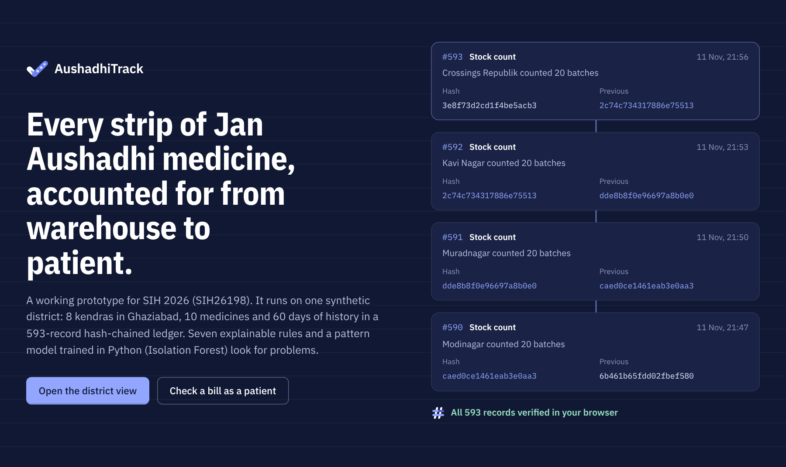

<p align="center">
  
</p>

<h1 align="center">✦ Manan Khurana</h1>

<hr />

<p align="center">
  <b><code>Mkhurana3</code></b> · CS undergraduate · machine learning · data science · computational biology
</p>

<p align="center">
  
</p>

<p align="center">
  
</p>

<hr />

## ✦ about me

<table>
  <tr>
    <td width="55%" valign="top">

```asm
; manan.asm · x86-64 · NASM

section .data
    name      db "Manan Khurana", 0
    handle    db "Mkhurana3", 0
    location  db "Delhi, India", 0

    focus     db "Machine Learning", 0
              db "Data Science", 0
              db "Computational Biology", 0

    open_to   db "Research internships", 0
              db "Open-source collaboration", 0

section .text
    global _start

_start:
    lea   rdi, [rel focus]
.loop:
    call  read_papers
    call  write_code
    call  ship
    jmp   .loop             ; never returns
```

</td>
    <td width="45%" valign="top" align="center">
      
    </td>
  </tr>
</table>

<hr />

## ✦ tech stack

**Languages**

<p>
  
  
  
  
  
</p>

**Machine Learning & Data Science**

<p>
  
  
  
  
  
</p>

**Bioinformatics**

<p>
  
</p>

**Web**

<p>
  
  
  
  
</p>

**Tools & Platforms**

<p>
  
  
  
  
  
</p>

<p align="center">
  
</p>

<hr />

## ✦ featured projects

<table>
  <tr>
    <td width="50%" valign="top" align="center">
      <a href="https://mkhurana3.github.io/AushadhiTrack/"></a>
      <h3>💊 AushadhiTrack</h3>
      <p>Smart India Hackathon 2026 prototype (SIH26198) that follows Jan Aushadhi medicine from warehouse to patient. A SHA-256 hash-chained ledger, seven explainable fraud rules, an Isolation Forest that catches patterns the rules miss, and Ed25519-signed QR receipts patients can check in English or Hindi.</p>
      
      
      
      
      
      
      <br /><br />
      <a href="https://mkhurana3.github.io/AushadhiTrack/"></a>
      <a href="https://github.com/Mkhurana3/AushadhiTrack"></a>
    </td>
    <td width="50%" valign="top" align="center">
      <a href="https://github.com/Mkhurana3/codon-shuffle"></a>
      <h3>🧬 codon-shuffle</h3>
      <p>Is the genetic code better than random? A reproduction of Haig &amp; Hurst (1991): we scored 100,000 random genetic codes on how much damage a single mutation does, and only 10 beat the real one. Plus an early AlphaFold follow-up on folded vs disordered protein regions. Built with <a href="https://github.com/antarahere">Antara</a>: I led the biology and worked on the code with her.</p>
      
      
      
      
      
      
      <br /><br />
      <a href="https://github.com/Mkhurana3/codon-shuffle"></a>
    </td>
  </tr>
</table>

<hr />

## ✦ github stats

<p align="center">
  
</p>

<p align="center"><sub>auto-updated daily by a GitHub Action</sub></p>

<hr />

## ✦ find me

<p align="center">
  <a href="https://github.com/Mkhurana3"></a>
  <a href="https://mkhurana3.github.io/AushadhiTrack/"></a>
</p>

<p align="center">
  
</p>
